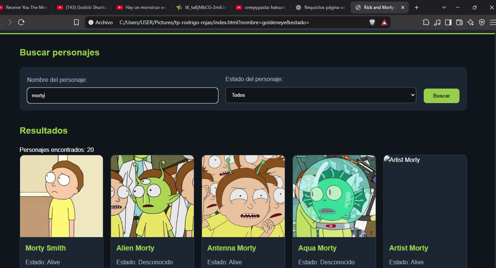

# Buscador de personajes — Rick and Morty

## Información del estudiante

- **Nombre:** Rodrigo Rojas
- **Variante:** A — Personajes
- **Asignatura:** Introducción a Fundamentos del Desarrollo Web
- **Institución:** UCSA

## Descripción del proyecto

Esta aplicación web permite buscar personajes de la serie *Rick and Morty* mediante la API pública [The Rick and Morty API](https://rickandmortyapi.com/).

El usuario puede realizar búsquedas utilizando el nombre del personaje, su estado (vivo, muerto o desconocido), o ambos criterios simultáneamente.

Cada resultado se presenta en una tarjeta que muestra la imagen del personaje, su nombre, estado, especie y lugar de origen.

La aplicación también incorpora validaciones, mensajes de carga y de error, y almacenamiento local (`localStorage`) para conservar los últimos criterios de búsqueda y restaurarlos al volver a cargar la página.

## Funcionalidades

- Buscar personajes por nombre.
- Filtrar personajes según su estado: vivo, muerto o desconocido.
- Combinar los criterios de búsqueda.
- Visualizar los resultados mediante tarjetas individuales.
- Mostrar imágenes e información de cada personaje.
- Validar los datos introducidos por el usuario.
- Mostrar mensajes de carga, error y resultados.
- Guardar los últimos criterios de búsqueda mediante `localStorage`.
- Restaurar los criterios de búsqueda al recargar la aplicación.

## Tecnologías utilizadas

- HTML5
- CSS3
- JavaScript (ES6+)
- Fetch API
- LocalStorage
- The Rick and Morty API

## Sitios publicados

- **GitHub Pages:** https://raidenoverdrive.github.io/tp-rodrigo-rojas/
- **Vercel:** https://tp-rodrigo-rojas.vercel.app/

## Captura de pantalla



## Estructura del proyecto

```text
tp-rodrigo-rojas/
├── index.html
├── README.md
├── .gitignore
├── css/
│   └── estilos.css
├── js/
│   └── app.js
└── img/
    └── CAPTURA.PNG
```

## Cómo ejecutar el proyecto localmente

1. Clonar el repositorio:

   ```bash
   git clone https://github.com/RaidenOverdrive/tp-rodrigo-rojas.git
   ```

2. Abrir la carpeta del proyecto en Visual Studio Code.
3. Ejecutar `index.html` utilizando Live Server o abrirlo directamente en un navegador compatible.

## Despliegue

El proyecto se encuentra publicado en GitHub Pages y Vercel.

Ambas plataformas están vinculadas al repositorio de GitHub y utilizan la rama `main` como fuente de publicación.

Los despliegues se actualizan automáticamente cada vez que se envían nuevos cambios mediante `git push`.

Se verificó el funcionamiento del despliegue continuo mediante la actualización del número de versión de la aplicación, pasando de la versión 1.0 a la versión 1.1 en ambas plataformas.